# Sales & Revenue Analysis Dashboard

An interactive sales analytics project built using Python, Pandas, Plotly, and Streamlit to explore sales performance, profitability, customer behaviour, product performance, and regional trends.

## Project Overview

This project analyzes retail sales data to identify business performance trends and uncover opportunities for improving profitability and decision-making.

The analysis includes data inspection, cleaning, exploratory data analysis (EDA), and an interactive dashboard with dynamic filters and visualizations.

## Objectives

- Analyze overall revenue, profit, order volume, and customer performance.
- Identify high-performing and loss-making products.
- Compare sales and profitability across regions and states.
- Examine customer purchasing behaviour and repeat customers.
- Understand the relationship between discount levels and profitability.
- Present key findings through an interactive business intelligence dashboard.

## Tools & Technologies

- **Python** – Data analysis and processing
- **Pandas & NumPy** – Data cleaning and manipulation
- **Matplotlib & Seaborn** – Exploratory data analysis
- **Plotly** – Interactive visualizations
- **Streamlit** – Interactive dashboard development
- **Jupyter Notebook** – Data exploration and analysis

## Dataset

**Source:** [Tableau Sample Superstore Dataset](https://public.tableau.com/app/sample-data/sample_-_superstore.xls)

The Tableau Sample Superstore dataset was used as a substitute because the original dataset described in the internship brief was not provided.

The downloaded dataset contained 10,194 records. After data inspection and filtering, 9,503 historical records were retained for analysis.

**Analysis period:** January 3, 2023 – November 16, 2026.

The analysis excludes 691 records with order dates after November 16, 2026. Records with shipping dates after the cutoff were retained when their order dates fell within the analysis period.

## Project Structure

```text
sales-revenue-dashboard/
│
├── data/
│   ├── sample_-_superstore.xls
│   └── processed_sales_data.csv
│
├── notebooks/
│   └── 01_data_inspection.ipynb
│
├── screenshots/
│
├── reports/
│
├── app.py
├── requirements.txt
├── README.md
└── .gitignore
```

## Key Performance Indicators

| Metric | Result |
|---|---:|
| Total Revenue | $2,183,041.79 |
| Total Profit | $274,860.29 |
| Total Orders | 4,759 |
| Total Quantity Sold | 35,970 |
| Total Customers | 804 |
| Unique Products | 1,857 |
| Average Order Value | $458.72 |
| Profit Margin | 12.59% |
| Average Recorded Discount | 15.60% |

## Key Findings

### 1. Category Performance
- Technology generated the highest revenue at $794,699.34.
- Office Supplies achieved the highest profit margin at approximately 18%.
- Furniture had the lowest profit margin at approximately 2.64%.

### 2. Product Performance
- Canon imageCLASS 2200 Advanced Copier was the highest-revenue and highest-profit product.
- Furniture Tables recorded a negative profit margin of approximately 8.04%.
- Bookcases and Supplies also recorded negative overall profitability.

### 3. Regional Performance
- West was the strongest region, generating $704,431.32 in revenue and $105,768.22 in profit.
- East ranked second in revenue.
- Central had the lowest regional profit margin at approximately 8.94%.

### 4. Customer Analysis
- The dataset contained 804 unique customers.
- 781 customers placed more than one order during the analysis period.
- The resulting repeat customer rate was approximately 97.14%.

This is a cumulative customer-level measure, not a cohort-based retention metric.

### 5. Discount Analysis
- Transactions with no recorded discount generated the highest overall profit.
- Higher discount levels were generally associated with weaker profitability.
- Discount levels of 30% and above frequently recorded negative total profit.

These findings show an association, not proof that discounts alone caused lower profitability.

## Interactive Dashboard

## Dashboard Preview

### Executive Overview

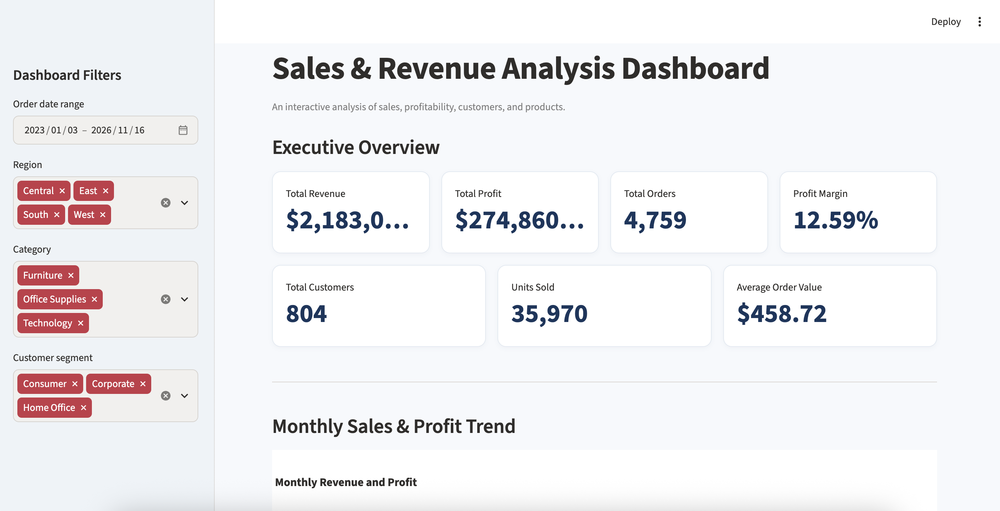

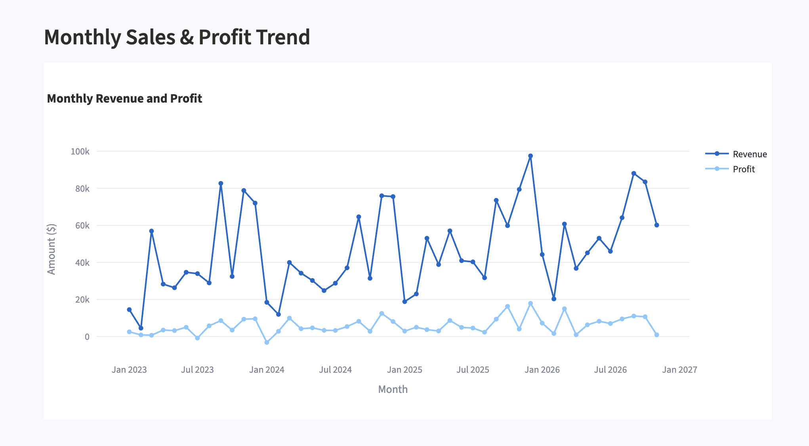

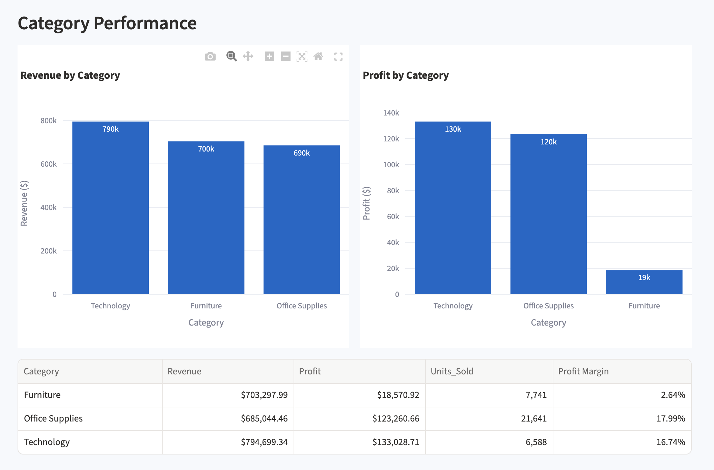

### Product Performance

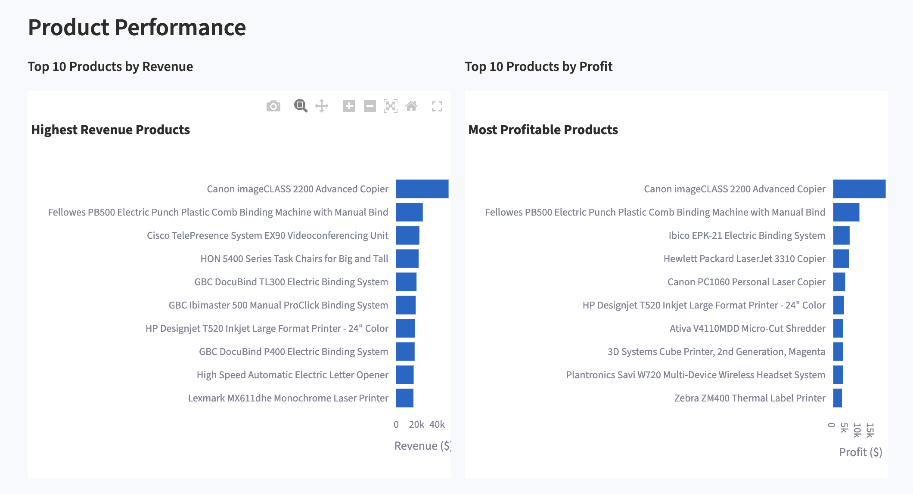

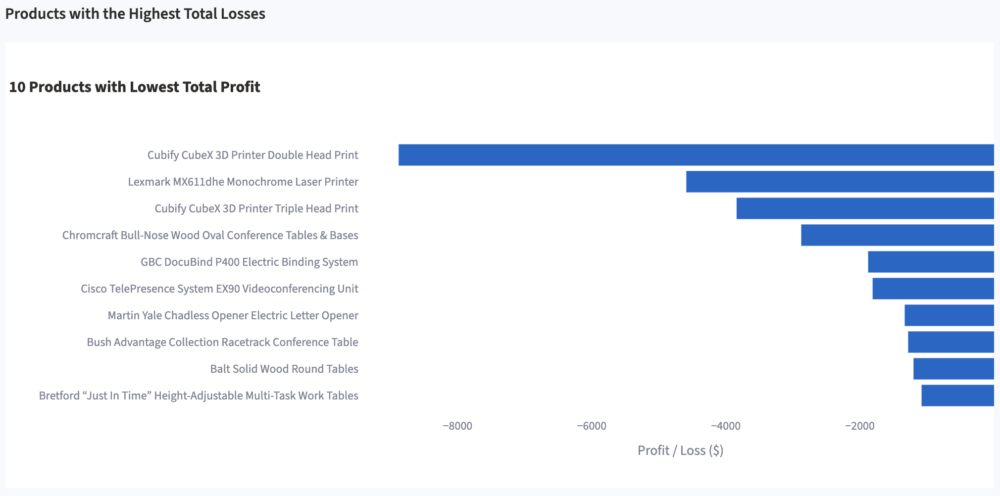

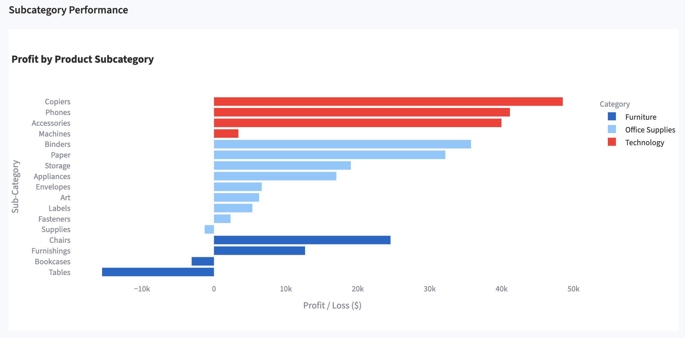

### Regional Performance

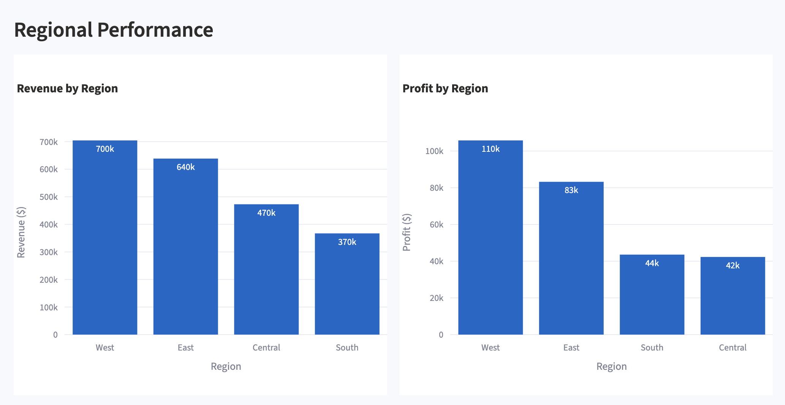

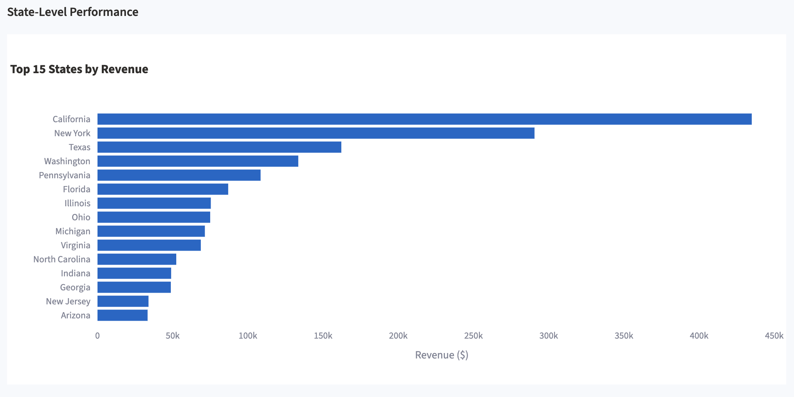

### Customer & Discount Analysis

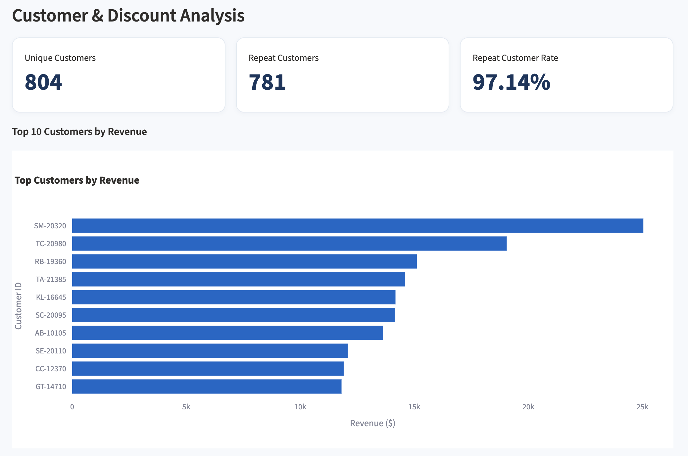

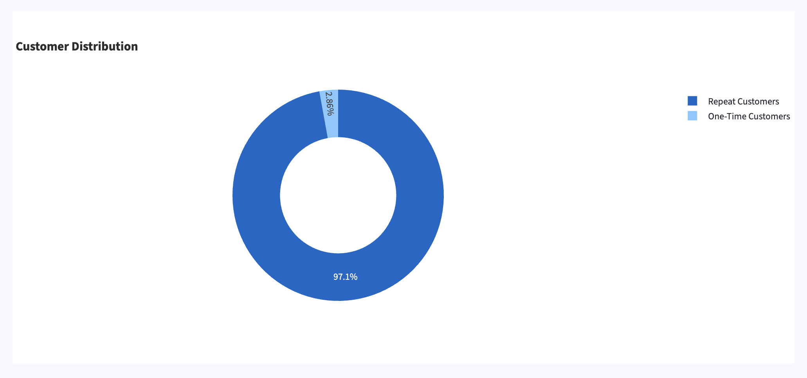

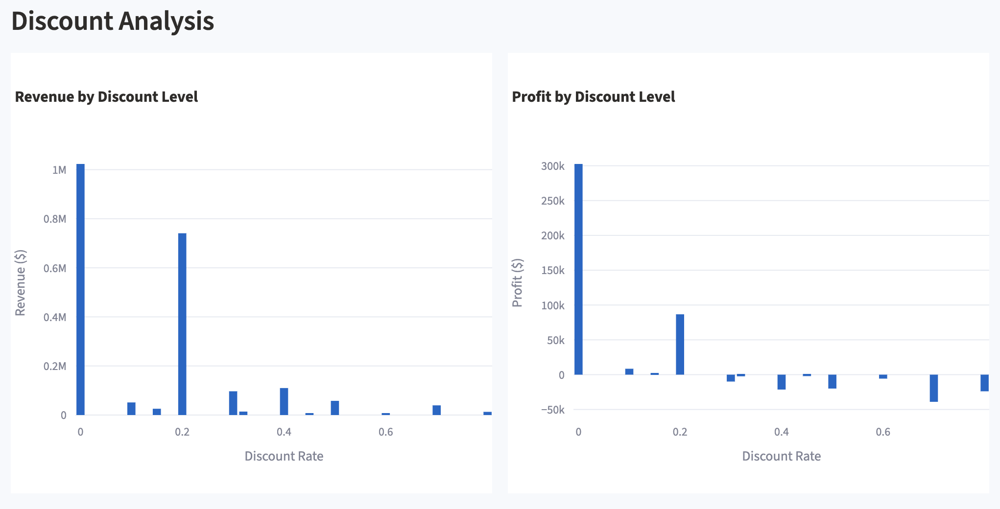

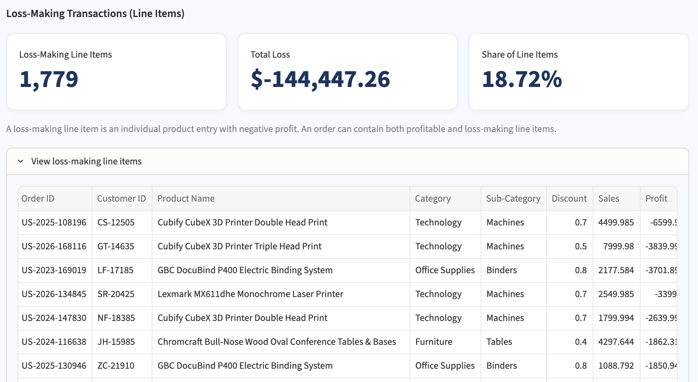


## How to Run the Project

### 1. Clone the repository

```bash
git clone YOUR_GITHUB_REPOSITORY_URL
cd sales-revenue-dashboard
```

### 2. Create a virtual environment

```bash
python3 -m venv .venv
source .venv/bin/activate
```

### 3. Install dependencies

```bash
pip install -r requirements.txt
```

### 4. Run the Streamlit dashboard

```bash
streamlit run app.py
```

The dashboard will open in your browser at:

`http://localhost:8501`

## Future Improvements

- Add year-over-year and month-over-month comparisons.
- Develop customer segmentation and cohort retention analysis.
- Add more advanced profitability and discount analysis.
- Improve dashboard interactivity and visual design.
- Explore forecasting for future sales and revenue trends.

---

**Project:** Sales & Revenue Analysis Dashboard  
**Built with:** Python | Pandas | Plotly | Streamlit  
**Purpose:** Data Analytics Internship Project